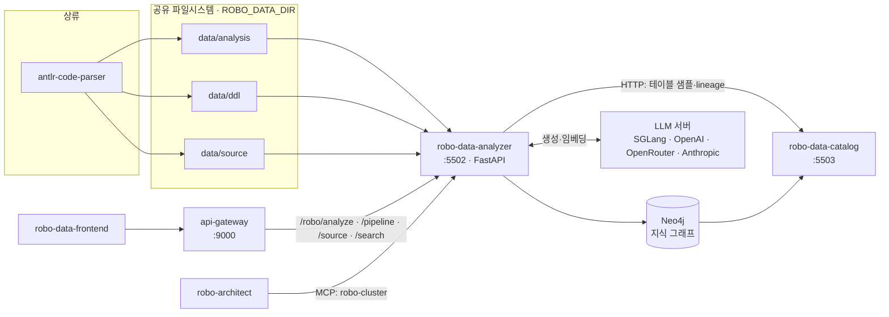
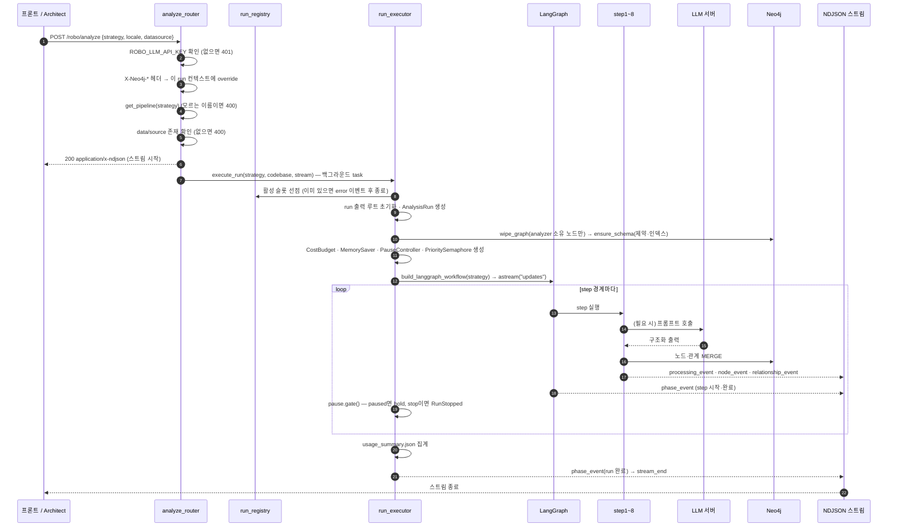
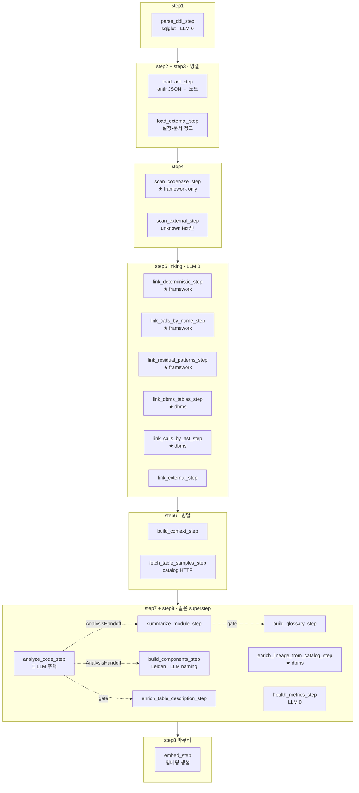
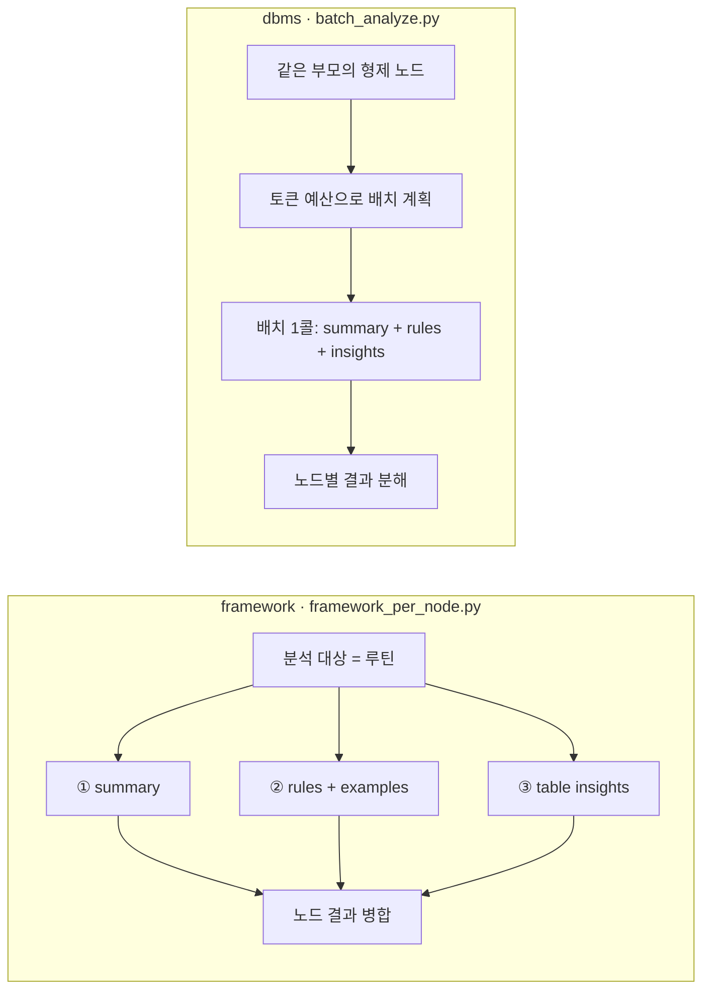
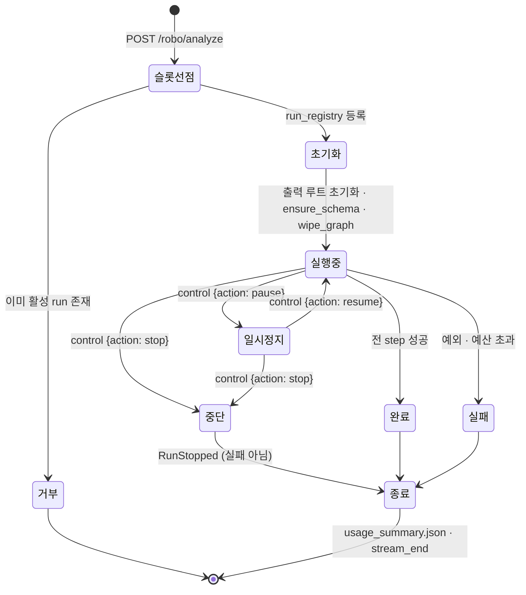
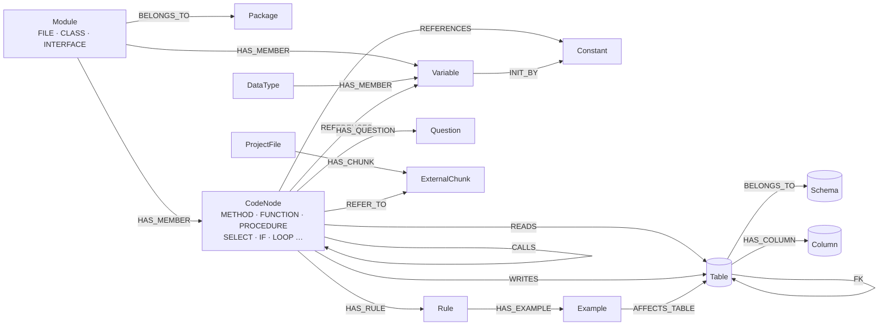
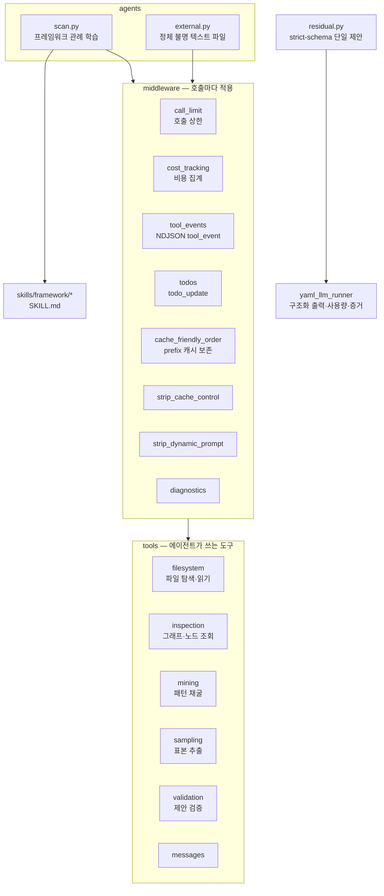
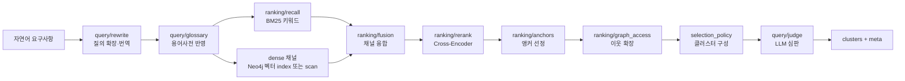

# ROBO Data Analyzer

레거시 코드베이스(Java · C · Python · Oracle PL/SQL · PostgreSQL)와 DDL을 정적 분석해
**Neo4j 지식 그래프**로 변환하는 LangGraph 파이프라인입니다. 호출 관계, 코드↔테이블 읽기/쓰기,
함수·모듈 요약, 비즈니스 규칙(Example Mapping), 부품(컴포넌트) 군집, 용어사전, 건강 지표,
의미 검색용 임베딩까지 한 번의 실행으로 만들어 냅니다.

FastAPI로 REST·NDJSON 스트림·MCP를 제공하며, 결정론으로 풀리는 단계는 LLM을 쓰지 않고
의미 판단이 필요한 곳에만 LLM을 씁니다.

---

## 목차

1. [무엇을 하는 서비스인가](#1-무엇을-하는-서비스인가)
2. [시스템 안에서의 위치](#2-시스템-안에서의-위치)
3. [설계 원칙](#3-설계-원칙)
4. [아키텍처](#4-아키텍처)
5. [요청 → 결과 시퀀스](#5-요청--결과-시퀀스)
6. [분석 파이프라인 8단계](#6-분석-파이프라인-8단계)
7. [Run 생명주기](#7-run-생명주기)
8. [지식 그래프 스키마](#8-지식-그래프-스키마)
9. [LLM 계층](#9-llm-계층)
10. [Agent·구조화 제안 계층](#10-agent구조화-제안-계층)
11. [의미 검색](#11-의미-검색)
12. [품질 게이트](#12-품질-게이트)
13. [API](#13-api)
14. [NDJSON 이벤트 계약](#14-ndjson-이벤트-계약)
15. [산출물](#15-산출물)
16. [설정](#16-설정)
17. [프로젝트 구조](#17-프로젝트-구조)
18. [실행](#18-실행)
19. [테스트](#19-테스트)
20. [문제 해결](#20-문제-해결)

---

## 1. 무엇을 하는 서비스인가

수십만 줄짜리 시스템을 물려받았는데 만든 사람은 떠났고 문서도 없는 상황을 전제로 만들어졌습니다.
사람이 코드를 한 줄씩 읽는 대신, 코드를 훑어 **탐색 가능한 지도**를 그려 줍니다.

| 산출 | 내용 |
|---|---|
| **호출 지도** | 어떤 함수가 어떤 함수를 부르는지 (`CALLS`) |
| **데이터 흐름** | 어떤 코드가 어떤 테이블을 읽고/쓰는지 (`READS` / `WRITES`) |
| **의미 요약** | 각 함수·모듈이 무슨 일을 하는지 (자연어 1~3줄 + 스테레오타입 + 논리명) |
| **업무 규칙** | 코드 속에 숨은 규칙과 그 사례 (`Rule` → `Example`, Example Mapping) |
| **미해결 질문** | 코드만으로는 판단할 수 없어 사람에게 물어야 하는 것 (`Question`) |
| **부품 군집** | 비슷한 일을 하는 함수 묶음(Leiden 군집)과 그 이름 |
| **용어사전** | 코드·주석에서 추출·검증된 도메인 표제어와 뜻 |
| **건강 지표** | 위험 지점 — 너무 크거나, 얽혀 있거나, 테이블을 과도하게 만지는 함수 |
| **외부 파일 연결** | 설정·매핑·문서 파일의 청크와 코드의 연결 (`REFER_TO`) |
| **의미 검색 인덱스** | 자연어 요구사항으로 관련 코드를 찾기 위한 임베딩과 검색 텍스트 |

두 가지 **분석 전략**을 지원합니다.

| 전략 | 대상 | 특징 |
|---|---|---|
| `framework` | Java · Python · C 등 응용 코드 | Scan Agent로 프레임워크 관례를 학습, 함수 단위 3분할 LLM 분석 |
| `dbms` | Oracle PL/SQL · PostgreSQL 프로시저 | Scan Agent 없음, DML 범위 → DDL 테이블 결정론 매칭, 형제 노드 배치 분석 |

---

## 2. 시스템 안에서의 위치



| 상대 | 연결 방식 | 내용 |
|---|---|---|
| `antlr-code-parser` | **파일시스템** | 파서가 만든 AST JSON(`data/analysis/`)과 DDL(`data/ddl/`)을 읽습니다. HTTP 호출은 없습니다 |
| `Neo4j` | Bolt | 분석 결과를 씁니다. 그래프가 이 서비스의 실질적 산출물입니다 |
| `robo-data-catalog` | **HTTP (아웃바운드)** | 테이블 샘플 행(`POST /tables/sample-context`)과 컬럼 계보를 가져옵니다 |
| `api-gateway` | HTTP (인바운드) | `/robo/analyze/**`, `/robo/pipeline/**`, `/robo/source`, `/robo/search/**`가 이 서비스로 라우팅됩니다 |
| `robo-data-frontend` | 게이트웨이 경유 | 분석 실행·진행 표시·코드뷰 |
| `robo-architect` | **MCP** | `robo-cluster` 서버의 `cluster_retrieve` / `node_detail` 도구로 레거시 코드를 의미 검색합니다. REST를 쓰지 않습니다 |
| `robo-data-fabric` | 없음 | 이 저장소에서 직접 호출하는 코드가 없습니다 |

---

## 3. 설계 원칙

**① 결정론이 먼저, LLM은 필요한 곳에만**
테이블 링킹, 호출 분류, 부품 군집(Leiden), 건강 지표는 LLM을 전혀 쓰지 않습니다. 요약·규칙
추출·설명 합성처럼 의미 판단이 필요한 곳에만 LLM을 씁니다.

**② 전략은 데이터, 분기는 없다**
`framework`/`dbms`의 차이는 `pipeline/strategies.py`의 `Strategy` 데이터 선언 한 곳에만
존재합니다. step 함수 안에 `if strategy.name == "dbms"` 같은 분기를 두지 않고, 분석 엔진·
컨텍스트 빌더·프롬프트 디렉터리를 주입받습니다.

**③ 그래프의 정체성은 `id` 하나**
모든 노드의 자기 식별 키는 `id` 단 하나입니다. 다른 노드를 가리키는 필드는 관계 역할명
(`owner_id`, `parent_id`)이고 값은 대상 노드의 `id`입니다. 중복 제거는 Neo4j `MERGE`가
책임집니다.

**④ 입구는 표준 `data/`로 통일**
`project_root`·`ddl_dir` 요청 필드는 역호환을 위해 받기만 하고 무시합니다. 소스 반입과
DDL/SOURCE 분류는 상류 파서의 단독 책임이며, 분석기는 항상
`ROBO_DATA_DIR/{source,ddl,analysis}`만 소비합니다.

업무 용어는 모델이 코드에서 자동 추측하지 않습니다. 필요하면 사람이
`ROBO_DATA_DIR/analysis/glossary.yaml`을 다음 폐쇄 형식으로 제공합니다. 파일이 없으면
용어사전은 명시적으로 비활성화됩니다. 모든 키는 필수이며 추가 키·중복 표기·잘못된 UTF-8은
분석 시작 전에 실패합니다.

```yaml
schema_version: "1.0"
terms:
  - canonical: 승인 대기
    aliases: [결제 대기]
    meaning: 결제 승인을 기다리는 업무 상태
    category: 결제 상태
```

**⑤ 모든 경계 상수는 환경변수**
임계값·배치 크기·호출 한도·비용 상한을 코드에 박지 않습니다. `shared/config/settings.py`가
유일한 진입점이며 `SETTINGS.<영역>.<이름>`으로 접근합니다.

**⑥ 조용한 실패 금지**
카탈로그가 활성인데 HTTP가 실패하면 step이 raise합니다(개별 자원 404만 정상). 처리 단위
실패는 `raise`가 단일 진입점이고, 스트림에 `failed` 이벤트로 표면화됩니다.

**⑦ 진행은 스트림 단일 채널**
폴링 엔드포인트가 없습니다. `/analyze`가 즉시 NDJSON 스트림을 반환하고 모든 진행·노드 생성·
도구 호출·오류가 그 한 채널로 흐릅니다.

---

## 4. 아키텍처

### 4.1 계층 구조

```mermaid
flowchart TB
    subgraph api[api — HTTP · MCP 경계]
        AR[analyze_router<br/>POST /robo/analyze · /control]
        SR[search_router<br/>POST /robo/search/semantic]
        SO[source_router<br/>GET /robo/source]
        MCP[mcp_app<br/>/robo/mcp · FastMCP]
    end

    subgraph exec[pipeline/execution — run 오케스트레이션]
        RE[run_executor]
        LB[langgraph_builder]
        WS[workflow_state]
        PC[pause_controller]
        RR[run_registry]
        AH[analysis_handoff]
        GDS[graph_delta_stream]
        AP[analysis_profile]
    end

    subgraph steps[pipeline/steps — 8단계]
        S1[step1 parse_ddl]
        S2[step2 load_ast]
        S3[step3 load_external]
        S4[step4 scan_project]
        S5[step5 linking]
        S6[step6 build_context]
        S7[step7 analyze_code]
        S8[step8 post_processing]
    end

    subgraph llm[llm — 모델 호출 인프라]
        CL[client · fanout · filters]
        RUN[runners/yaml_llm_runner]
        CFG[configs/*.yaml]
        PR[prompts/framework · dbms · common]
        EMB[embedder]
        RC[response_cache]
        RG[repetition_guard]
        TR[tracing]
        US[usage: token · pricing · cost_budget]
    end

    subgraph agents[agents — 자율 에이전트]
        SC[scan]
        RES[residual strict-schema 제안]
        EXT[external]
        RT[runtime · contracts]
        MW[middleware 8종]
        TL[tools 6종]
        SK[skills/framework/*]
    end

    subgraph graph[graph — Neo4j 영속]
        SCH[schema: graph_nodes · graph_edges<br/>rel_types · node_ids · constraints]
        ND[nodes/*.py — MERGE Cypher]
        ED[edges/*.py — MERGE Cypher]
        CLI[neo4j_client · connection_context]
    end

    subgraph search[search — 의미 검색]
        CO[corpus]
        QU[query: rewrite · judge · glossary]
        RA[ranking: recall · fusion · rerank · retriever]
    end

    subgraph shared[shared — 공통]
        CFGS[config/settings]
        EV[events: ndjson_stream · runtime_logger<br/>processing_events]
        FI[files: cache · paths · source_excerpt]
        CC[concurrency/priority_semaphore]
        GR[graphs/call_cycles]
    end

    QG[pipeline/quality_gates<br/>branch_inventory · grounding · lexing]
    INT[integrations/catalog]

    AR --> RE
    SR --> search
    MCP --> search
    RE --> LB --> steps
    RE --> PC
    RE --> RR
    steps --> AH
    steps --> llm
    steps --> agents
    steps --> graph
    steps --> INT
    steps --> QG
    graph --> GDS --> EV
    llm --> US
    agents --> llm
    steps --> shared
```

### 4.2 패키지별 책임

| 패키지 | 책임 | 핵심 모듈 |
|---|---|---|
| `api/` | FastAPI 라우터, MCP 서버 마운트, 소스 파일 해소 | `analyze_router`, `search_router`, `source_router`, `mcp_app`, `source_resolver` |
| `pipeline/` | 전략 선언, 언어 매핑 | `strategies.py`, `languages.py` |
| `pipeline/execution/` | run 1회의 수명주기 — 출력 초기화, LangGraph 빌드·소비, 일시정지, 그래프 델타 스트림, 핸드오프 | `run_executor`, `langgraph_builder`, `pause_controller`, `analysis_handoff`, `graph_delta_stream` |
| `pipeline/models/` | 워크플로 상태·분석 컨텍스트·LLM 출력 스키마 | `analysis_context`, `analysis_meta`, `code_analysis_output` |
| `pipeline/steps/step1~8/` | 실제 분석 단계 구현 | 각 폴더가 한 단계 |
| `pipeline/quality_gates/` | LLM 산출물의 코드 근거를 결정론으로 재는 측정 계층 | `branch_inventory`, `grounding`, `lexing` |
| `graph/` | Neo4j 노드·관계 스키마, MERGE Cypher, 드라이버, 요청별 연결 override | `schema/`, `nodes/`, `edges/`, `neo4j_client`, `connection_context` |
| `llm/` | 모델 호출 인프라 — 설정 로딩, YAML 프롬프트 실행, 팬아웃, 캐시, 반복 차단, 추적, 비용 | `runners/`, `configs/`, `prompts/`, `usage/`, `client`, `embedder` |
| `agents/` | Scan·외부 파일 Agent와 residual 단일 구조화 제안, 도구·미들웨어·스킬 | `scan`, `residual`, `external`, `runtime`, `middleware/`, `tools/`, `skills/` |
| `search/` | 의미 검색 — 코퍼스 적재, 질의 변환·심판, 리콜·융합·재랭킹 | `corpus/`, `query/`, `ranking/`, `service` |
| `integrations/` | 카탈로그 서비스 HTTP 클라이언트 | `catalog` |
| `shared/` | 설정 단일 진입점, 이벤트·로깅, 파일 캐시, 우선순위 세마포어, 그래프 유틸 | `config/settings`, `events/`, `files/`, `concurrency/`, `graphs/` |
| `scripts/` | 운영자 CLI | `analyze_data_dir`, `reembed_graph`, `reset_neo4j_schema` 등 |

### 4.3 기술 스택

| 영역 | 사용 |
|---|---|
| 워크플로 | LangGraph 1.x (`StateGraph` + `MemorySaver` 체크포인터 + `astream`) |
| LLM | LangChain 1.x, `langchain-openai`, `langchain-anthropic`, deepagents 0.2+ |
| Web | FastAPI, uvicorn, `mcp` (FastMCP streamable-http) |
| 그래프 DB | neo4j 5.27+ |
| SQL 파싱 | sqlglot 27+ (DDL 전용) |
| 군집 | leidenalg + igraph |
| 임베딩·재랭킹 | sentence-transformers, rank-bm25 |
| 외부 파일 파싱 | charset-normalizer, javaproperties, lxml, json-source-map, markdown-it-py, regex |
| 기타 | pydantic 2.x, httpx, tenacity, pyyaml, python-dotenv |

---

## 5. 요청 → 결과 시퀀스



---

## 6. 분석 파이프라인 8단계

### 6.1 전체 흐름



`Strategy.steps`의 튜플은 **같은 LangGraph superstep**을 의미합니다. step7과 step8을 한
superstep에 두는 이유는, 노드 사이에 배리어를 두면 후처리가 step7의 마지막 호출까지 기다리는데
실제로 후처리가 읽는 값은 step7의 일부 분할에서만 나오기 때문입니다. 각 step이
`AnalysisHandoff`로 자기 의존이 풀리는 시점을 스스로 기다리고, 남는 LLM 슬롯을 낮은 우선순위로
채웁니다. 총 동시 요청 수는 늘지 않습니다 — `PrioritySemaphore`가 run에 하나뿐입니다.

### 6.2 전략별 step 구성

| step | framework | dbms | LLM |
|---|:---:|:---:|:---:|
| `parse_ddl_step` | ✅ | ✅ | ✗ |
| `load_ast_step` | ✅ | ✅ | ✗ |
| `load_external_step` | ✅ | ✅ | ✗ |
| `scan_codebase_step` | ✅ | — | 🤖 Agent |
| `scan_external_step` | ✅ | ✅ | 🤖 Agent |
| `link_deterministic_step` | ✅ | — | ✗ |
| `link_calls_by_name_step` | ✅ | — | ✗ |
| `link_residual_patterns_step` | ✅ | — | 🤖 Agent |
| `link_dbms_tables_step` | — | ✅ | ✗ |
| `link_calls_by_ast_step` | — | ✅ | ✗ |
| `link_external_step` | ✅ | ✅ | ✗ |
| `build_context_step` | ✅ | ✅ | ✗ |
| `fetch_table_samples_step` | ✅ | ✅ | ✗ (HTTP) |
| `analyze_code_step` | ✅ per-node 3분할 | ✅ 형제 배치 | 🔵 |
| `summarize_module_step` | ✅ | ✅ | 🔵 |
| `build_components_step` | ✅ | ✅ | 🔵 (naming만) |
| `build_glossary_step` | ✅ | ✅ | 결정론 |
| `enrich_table_description_step` | ✅ | ✅ | 🔵 |
| `enrich_lineage_from_catalog_step` | — | ✅ | ✗ (HTTP) |
| `health_metrics_step` | ✅ | ✅ | ✗ |
| `embed_step` | ✅ | ✅ | 임베딩 |

DBMS 파이프라인에 `link_deterministic_step`이 **없는 것**은 의도된 설계입니다 — DBMS의 R/W
단일 생산자는 `link_dbms_tables_step`이며, 이 부재는 계약 테스트가 고정합니다.

### 6.3 단계별 상세

#### step1 — DDL 파싱 (`step1_parse_ddl`)

`data/ddl/`의 SQL을 sqlglot으로 파싱해 `Schema` · `Table` · `Column` · `FK` 노드를 만듭니다.
DDL이 테이블 진실의 기준이며, 이후 어떤 단계도 새 테이블을 만들지 않고 관계만 붙입니다.
`COMMENT ON`을 1순위, `--`/`/* */` 주석을 2순위로 설명을 채우고 출처를 `description_source`에
남깁니다.

| 모듈 | 역할 |
|---|---|
| `ddl_parser.py` | sqlglot 기반 CREATE TABLE/VIEW/INDEX/SEQUENCE 해석, 컬럼·제약·주석 추출 |
| `parse_ddl_step.py` | 파싱 결과를 그래프 노드로 변환하고 상태에 싣기 |

#### step2 — AST 적재 (`step2_load_ast`)

`data/analysis/`의 AST JSON을 읽어 `Package` · `Module` · `CodeNode` · `Variable` ·
`Constant` · `DataType` 노드와 `HAS_MEMBER` · `PARENT_OF` · `BELONGS_TO` · `NEXT` 관계를
만듭니다. 원문 라인 범위를 이용해 각 노드의 `code_text`를 채웁니다.

| 모듈 | 역할 |
|---|---|
| `dispatch.py` | 전략별 리더 선택 |
| `framework_reader.py` | Java/Python/C AST → 노드 (클래스·메서드 트리) |
| `dbms_reader.py` | PL/SQL·PostgreSQL AST → 노드 (중첩 DML range를 `parent_id` 트리로 흡수) |
| `node_builders.py` | 공통 노드 생성 |
| `node_identity_registry.py` | `id` 충돌 방지·유일성 보장 |
| `import_scopes.py` | import/using 스코프 해석 (호출 이름 해소의 근거) |
| `token_matcher.py` | 토큰 단위 매칭 유틸 |

#### step3 — 외부 파일 적재 (`step3_load_external`)

설정·매핑·문서 파일(XML · properties · JSON · YAML · Markdown 등)을 읽어 `ProjectFile`과
`ExternalChunk` 노드를 만듭니다. 각 청크는 **원문 span**(바이트 오프셋)을 보존하고
`span_verifier`가 그 정확성을 검증합니다.

| 모듈 | 역할 |
|---|---|
| `inventory.py` | 대상 파일 수집·분류 |
| `encoding_reader.py` | charset-normalizer 기반 인코딩 해소 |
| `parsers/span_xml.py` · `span_config.py` · `span_markdown.py` | 포맷별 span 보존 파싱 |
| `parsers/document_adapters.py` | 문서 어댑터 |
| `parsers/key_roles.py` | 키의 역할 분류(참조 키 후보 판별) |
| `chunk_builder.py` | 청크 경계 결정 |
| `span_verifier.py` | span ↔ 원문 일치 검증 |

#### step4 — 프로젝트 스캔 (`step4_scan_project`)

**framework 전용.** Scan Agent가 코드베이스를 1회 훑어 이 프로젝트가 쓰는 프레임워크 관례를
학습합니다 — 어떤 호출 패턴이 DB 접근인지, wrapper 함수는 무엇인지, 테이블명이 어디에서
오는지. 산출물은 `table_access_patterns`(정규식 + op 매핑)이며, 매치된 호출 지점 중 op 토큰이
인식된 비율이 `ROBO_AGENT_SCAN_REGEX_MIN_OP_RATIO`(기본 0.5) 미만이면 탈락시킵니다.

`scan_external_step`은 양 전략 공통으로, 정체를 모르는 텍스트 파일에 대해 스킬을 다시 읽거나
에이전트를 호출합니다.

| 모듈 | 역할 |
|---|---|
| `scan_codebase_step.py` | Scan Agent 구동 |
| `structure_miner.py` | 디렉터리·파일 구조 요약 (에이전트 입력) |
| `scanner_input_collector.py` | 샘플 코드 수집 |
| `scan_external_step.py` · `external_skills.py` | 외부 파일 스킬 적용·에이전트 |

#### step5 — 링킹 (`step5_linking`) · **LLM 0**

코드와 테이블, 코드와 코드, 코드와 외부 파일을 결정론으로 연결합니다.

| 하위 | 모듈 | 역할 |
|---|---|---|
| `link_tables/` | `regex_table_linker.py` | Scan Agent가 준 패턴으로 코드에서 테이블 접근 추출 (framework) |
| | `link_dbms_tables_step.py` | DML range → DDL 테이블 결정론 매칭 (dbms) |
| | `link_residual_patterns_step.py` | 미해결 접근을 샘플링해 strict schema로 패턴/변환을 한 번 제안받고 결정론 검증 (기본 최대 3라운드 × 30샘플) |
| `link_calls/` | `call_classifier.py` | 호출 대상 분류 — 내부/외부/표준 라이브러리/빌트인 |
| | `call_linker.py` | 이름 기반 호출 해소 + wrapper 통합 |
| | `link_calls_by_ast_step.py` | AST `CALL` 노드 기반 분류, 빌트인·자기루프 드롭 (dbms) |
| | `stdlib/*.json` | C · Java · Python 표준 라이브러리 심볼 목록 |
| `link_external/` | `key_index.py` · `target_index.py` | 외부 파일 키와 코드 심볼 색인 |
| | `resolver_catalog.py` · `literal_constants.py` | 해석기 호출과 유일한 리터럴 상수 근거로 외부 조각 연결 |
| | `linker.py` | `REFER_TO` 관계 생성 |

#### step6 — 컨텍스트 구성 (`step6_build_context`)

각 코드 노드를 LLM에 보낼 때 함께 줄 재료를 조립합니다 — 부모·형제 컨텍스트, 참조 심볼,
제어 구조 서브트리, 관련 테이블의 컬럼·샘플 행, 외부 파일 근거. 매우 큰 노드는
`large_code_one_liner`로 한 줄 요약해 토큰을 줄입니다.

`fetch_table_samples_step`은 카탈로그 서비스에 `POST /tables/sample-context`로 표본 행을
요청합니다(HTTP 지연을 숨기려 `build_context_step`과 병렬 실행).

#### step7 — 코드 분석 (`step7_analyze_code`) · **LLM 주력**

전략별로 다른 엔진이 주입됩니다.



| 모듈 | 역할 |
|---|---|
| `step_entry.py` | 전략이 주입한 엔진 호출 (엔진 종류를 모름) |
| `framework_per_node.py` | 함수 1개당 3분할 팬아웃 |
| `three_split_llm_fanout.py` | 3분할 병렬 호출·검증·재시도 |
| `batch_analyze.py` | 형제 노드를 한 콜로 묶는 DBMS 배치 엔진 |
| `batch_planner.py` · `ast_budget_splitter.py` | 토큰 예산 기반 배치 편성 |
| `analysis_order.py` | 의존 순서 결정 (호출 그래프 위상) |
| `example_mapping_builder.py` | 규칙·사례 → `Rule` / `Example` / `Question` 노드 |
| `rw_table_filter.py` | 읽기/쓰기 테이블 후보 정제 |
| `rule_quality.py` · `summary_quality.py` · `concern_retry.py` | 산출물 품질 검사와 부분 재시도 |
| `human_glossary.py` | 사람 제공 `analysis/glossary.yaml` 폐쇄 입력·provenance 검증 |
| `result_sink.py` | 결과를 상태·그래프로 흘림 |

#### step8 — 후처리 (`step8_post_processing`)

| 모듈 | 역할 | LLM |
|---|---|:---:|
| `summarize_module_step.py` | 멤버 분석을 종합해 모듈 요약·스테레오타입·논리명 도출 | 🔵 |
| `build_components_step.py` | 호출 그래프에 Leiden 군집 → `FUNCTION.component_id` 속성, 병렬 LLM naming | 🔵 |
| `build_glossary_step.py` | 검증된 사람 제공 프로젝트 용어사전을 그대로 저장 | 결정론 |
| `enrich_table_description_step.py` | 코드 인사이트로 테이블·컬럼 설명·논리명 보강 | 🔵 |
| `enrich_lineage_from_catalog_step.py` | 카탈로그 컬럼 계보로 보강 (dbms) | ✗ |
| `health_metrics_step.py` | 결정론 그래프만 읽어 건강 지표 산출 | ✗ |
| `embed_step.py` | 노드·테이블·컬럼 임베딩 생성 (`ROBO_EMBED_*`) | 임베딩 |
| `table_logical_names.py` | 테이블 논리명 정규화 | ✗ |
| `handoff_skip.py` | 핸드오프 조건 미충족 시 건너뛰기 | — |

컴포넌트는 **합성 노드로 만들지 않습니다** — 군집 멤버십은 `FUNCTION.component_id` 속성이
단일 진실이고, 이름·그룹 간 호출은 거기서 파생됩니다.

---

## 7. Run 생명주기



| 특성 | 동작 |
|---|---|
| **동시 실행** | 분석은 동시 1건. 두 번째 요청은 `ConcurrentAnalysisRunError`로 거부되며, 슬롯 선점이 출력 초기화·그래프 wipe보다 **먼저** 일어나 경쟁을 막습니다 |
| **run 식별** | 매 `/analyze` 호출이 독립 run. `run_id`가 유일 식별자 |
| **일시정지** | 소프트 hold — astream 소비 루프가 step 경계마다 `pause.gate()`를 통과. 프로세스가 살아 있는 동안만 유효 |
| **중단** | `RunStopped`로 **정상 종료**(실패 아님) |
| **체크포인트** | `MemorySaver` — run 1회 안의 state 전파용. 디스크 재개 없음 |
| **스트림 종료** | 클라이언트가 스트림을 끊으면 그 run은 종료됩니다 |
| **비용 차단** | `CostBudget`이 `ROBO_BUDGET_RUN_USD`(기본 $20)를 넘으면 run을 차단 |
| **검색은 예외** | `/search/semantic`은 읽기 전용이라 동시 여러 건 허용 |

---

## 8. 지식 그래프 스키마

### 8.1 노드와 관계



### 8.2 노드 타입

| dataclass | Neo4j 라벨 | 생성 단계 | `id` 형식 |
|---|---|---|---|
| `Schema` | `SCHEMA` | step1 | `db:<db>.<name>` |
| `Table` | `TABLE` | step1 | `db:<db>.<schema>.<name>` |
| `Column` | `COLUMN` | step1 | 부모 Table id + `.<column>` (예: `db:prod.PUBLIC.USERS.user_id`) |
| `Package` | `PACKAGE` | step2 | `code:` + 네임스페이스 (예: `code:com.example`) |
| `Module` | `label` 필드 = AST type (`FILE`·`CLASS`·`INTERFACE` …) | step2 | `code:` + 확장자 포함 상대경로 (예: `code:sub/dir/foo.h`) 또는 `code:` + 패키지·클래스 |
| `CodeNode` | `label` 필드 = AST type (`METHOD`·`FUNCTION`·`PROCEDURE`·`SELECT`·`IF` …) | step2 | 컨테이너 id + `:` + 이름 (예: `code:member.c:member_row_t:member_id`). 동명 충돌 시 `@<시작줄>` 접미 |
| `Variable` | `FIELD`·`MEMBER`·`GLOBAL_VARIABLE`·`VARIABLE`·`PARAMETER` … | step2 | 위와 동일한 컨테이너 경로 규칙 |
| `Constant` | `DEFINE`·`CONSTANT_FIELD` … | step2 | 위와 동일 |
| `DataType` | `STRUCT`·`UNION`·`ENUM` … | step2 | 위와 동일 |
| `Rule` | `RULE` | step7 | 정규화 statement의 MD5 앞 12자 |
| `Example` | `EXAMPLE` | step7 | `<함수 id>::R<ordinal>::<rule 해시>::<idx>` |
| `Question` | `QUESTION` | step7 | `<함수 id>::Q<idx>` |
| `ProjectFile` | `PROJECT_FILE` | step3 | `file:<project>/<프로젝트 상대경로>` |
| `ExternalChunk` | `EXTERNAL_CHUNK` | step3 | `<file id>:chunk:<char_start>-<char_end>` (파생 문서는 `:chunk:derived-<n>`) |

노드 종류는 별도 `node_type` 속성이 아니라 **Neo4j 라벨 하나**로 표현하며, 그 값은 AST의
`type`입니다.

`id`의 단일 진실은 `graph/schema/node_ids.py`입니다. 세 가지 네임스페이스로 세계를 가릅니다.

| 접두 | 대상 | 이유 |
|---|---|---|
| `code:` | 코드 심볼 | 구분자 `:`는 파일명(Windows 금지)에도 SQL/C 식별자에도 들어갈 수 없어 **구조적으로** 겹칠 수 없습니다 |
| `db:` | DB 객체 | 테이블 `cart`와 파일 `cart.c`가 같은 `id`가 되어 잘못된 엣지가 박히던 문제를 근본 차단 |
| `file:` | 외부 프로젝트 파일 | |

유일성은 지어내지 않고 이미 유일한 것에서 가져옵니다 — 파일시스템(경로, **확장자 포함**),
언어(한 컨테이너 안 동명 금지), DB(db·스키마·테이블·컬럼). **`id`는 불투명한 열쇠입니다** —
잘라서 부모나 이름을 알아내지 않고, 소속은 `owner_id` 속성이나 `HAS_COLUMN`/`HAS_MEMBER`
관계로 찾습니다.

### 8.4 소유권과 추가 라벨

| 표식 | 의미 |
|---|---|
| `:ANALYZER_OWNED` 라벨 | 분석기가 만든 모든 노드에 붙는 공통 마커. 코드 노드 라벨은 AST type의 **열린 집합**이라 종류별 제약을 열거할 수 없어, 이 마커에 `id` UNIQUE 제약을 겁니다. 이 인덱스가 없으면 무라벨 `MATCH by id`가 전체 노드 스캔이 됩니다 |
| `graph_owner: "analyzer"` 속성 | 소유자 표식. `wipe_graph`는 이 값을 가진 노드만 지우므로 같은 DB의 Architect 설계 그래프와 Fabric 연결 registry는 보존됩니다 |
| stereotype 추가 라벨 | `stereotype` 속성(PascalCase)을 UPPER_SNAKE 라벨로도 부여합니다(`Service` → `:SERVICE`, `ApplicationService` → `:APPLICATION_SERVICE`). Architect의 PascalCase DDD 라벨과 네임스페이스를 분리하기 위한 표기 규칙이며, 값은 `ontology_roles.yaml` 풀에서 검증된 것만 사용합니다 |

UNIQUE 제약은 `ANALYZER_OWNED` · `SCHEMA` · `TABLE` · `COLUMN` · `PACKAGE` · `RULE` ·
`EXAMPLE` · `QUESTION` · `PROJECT_FILE` · `EXTERNAL_CHUNK`에 걸려 있고, 조회 인덱스는
`TABLE.schema` 하나입니다. 스키마는 `IF NOT EXISTS`로 idempotent하게 보장하며 매 run
drop-recreate 하지 않습니다.

### 8.3 관계 타입

관계 타입 문자열은 `graph/schema/rel_types.py`에서만 상수로 정의하며 Cypher에 직접 박지
않습니다.

| 관계 | 방향 | 출처 |
|---|---|---|
| `CALLS` | CodeNode → CodeNode | step5 링킹 |
| `PARENT_OF` | CodeNode → CodeNode | step2 (AST 중첩) |
| `HAS_MEMBER` | 그릇(FILE/CLASS/PACKAGE/DataType) → 멤버 | step2 |
| `REFERENCES` | CodeNode → Variable/Constant | step2·5 |
| `INIT_BY` | Variable → 출처 노드 | step2 |
| `NEXT` | 구문 → 구문 (실행 순서) | step2 (dbms) |
| `READS` / `WRITES` | CodeNode → Table | step5 링킹 |
| `BELONGS_TO` | Table→Schema, FILE/CLASS→Package | step1·2 |
| `HAS_COLUMN` | Table → Column | step1 |
| `FK` | Table → Table | step1 |
| `HAS_RULE` | CodeNode → Rule | step7 |
| `HAS_EXAMPLE` | Rule → Example | step7 |
| `HAS_QUESTION` | CodeNode → Question | step7 |
| `AFFECTS_TABLE` | Example → Table | step7 |
| `REFER_TO` | METHOD/FUNCTION → ExternalChunk | step5 외부 링킹 |
| `HAS_CHUNK` | ProjectFile → ExternalChunk | step3 |

### 8.5 벡터 속성

`Table` · `Column` · `CodeNode`는 `embedding` 속성(`metadata={"vector": True}`)을 갖습니다.
`embed_step`이 채우고 검색의 dense 채널이 소비합니다. `ROBO_SEARCH_DENSE_IMPL`로 Neo4j 벡터
인덱스(`index`)와 전량 코사인 스캔(`scan`)을 전환할 수 있습니다.

---

## 9. LLM 계층

### 9.1 설정 — `llm/configs/<name>.yaml`

YAML 하나가 **모델 + 배포 환경 한 묶음**입니다. `.env`에는 이름과 비밀만 둡니다.

```bash
ROBO_LLM_CONFIG=qwen36_sglang_local   # llm/configs/qwen36_sglang_local.yaml 사용
ROBO_LLM_API_KEY=<secret>             # YAML에는 절대 넣지 않음
```

| 필드 | 필수 | 의미 |
|---|:---:|---|
| `provider` | ✅ | `openai` / `anthropic` / `openrouter` / `sglang` / `vllm` 등. **`anthropic` 외는 모두 OpenAI 호환 처리** |
| `api_base` | anthropic 외 ✅ | endpoint URL |
| `model` | ✅ | 모델 이름 |
| `model_small` | | 큰 함수 one-liner 등에 쓸 작은 모델. 비우면 `model` 사용 |
| `max_tokens` | ✅ | 최대 출력 토큰 |
| `timeout_seconds` | ✅ | 호출 타임아웃 |
| `verify_ssl` | ✅ | 사내 자체 인증서면 `false` |
| `sampling.temperature` · `sampling.top_p` | ✅ | 전 provider 공통 |
| `reasoning_effort` | ✅ | `none`/`low`/`medium`/`high` — **cross-provider 추상화** |
| `extra_body` | ✅(빈 dict 가능) | provider 비표준 인자 |

`reasoning_effort` 변환 규칙:

| provider | 처리 |
|---|---|
| OpenAI (o-series, gpt-5) | `none`은 미전달, `low/medium/high`만 전달 — 자동 |
| Anthropic (Claude 3.7+) | `thinking={"type":"disabled"}` 또는 budget 1k/4k/16k — 자동 |
| SGLang / vLLM / 로컬 | YAML `extra_body.chat_template_kwargs.enable_thinking`을 운영자가 직접 명시 — 자동 주입 없음 |
| OpenRouter | OpenAI 표준으로 normalize. backend별 호환성은 보장 안 됨 |

동봉된 config: `qwen36_sglang_local` · `qwen36_openrouter` · `gpt54_mini_openai` ·
`gpt54_nano_openrouter`.

### 9.2 프롬프트 — `llm/prompts/`

YAML 프롬프트를 `yaml_llm_runner`가 실행합니다. 전략별 디렉터리가 `Strategy.prompts_dir`로
주입됩니다.

| 위치 | 내용 |
|---|---|
| `prompts/framework/` | `code_summary` · `code_table_insights` · `table_description` · `_common` |
| `prompts/dbms/` | `code_summary_batch` · `code_table_insights_batch` · `table_description` · `_common` |
| `prompts/common/*.md` | 산출물 계약 문서 — function summary · semantic frame · summary · table description |
| `prompts/prompt_hashes.json` | 프롬프트 prefix 캐시 계약 검증용 해시 |

### 9.3 호출 인프라

| 모듈 | 역할 |
|---|---|
| `runners/yaml_llm_runner.py` | YAML 프롬프트 → 구조화 출력. 검증·재시도의 중심 |
| `runners/invocation.py` · `prompt_rules.py` · `prompt_values.py` | 호출 조립, 규칙 적용, 값 바인딩 |
| `runners/transport_retry.py` | 전송 계층 재시도 (tenacity) |
| `client.py` | provider별 LangChain 클라이언트 생성 |
| `fanout.py` | 병렬 팬아웃 |
| `filters.py` · `messages.py` | 메시지 필터·마스킹 (비밀은 항상 마스킹) |
| `response_cache.py` | 콘텐츠 해시 응답 캐시. 기본 ON, LRU 상한 `ROBO_LLM_RESPONSE_CACHE_MAX_MB`(기본 512MB) |
| `repetition_guard.py` | 스트리밍 중 반복 폭주 실시간 차단. 기본 ON |
| `tracing.py` | 호출 추적 (contextvars 기반) |
| `embedder.py` | 임베딩 생성 (`ROBO_EMBED_*`) |
| `usage/token_usage.py` · `pricing.py` · `cost_budget.py` · `usage_jsonl_writer.py` | 토큰 집계, 가격표(`llm_pricing.yaml`), 예산 회로 차단기, JSONL 기록 |

임베딩 기본값은 `sglang` provider의 `BAAI/bge-m3`(1024차원)이며 동시성 기본 8입니다.
동시성을 올리면 GPU 메모리 경합으로 **오히려 느려집니다**.

---

## 10. Agent·구조화 제안 계층

deepagents 기반 자율 에이전트 2종과 단일 구조화 residual 제안이 결정론으로 풀리지 않는
지점에만 투입됩니다.



| 에이전트 | 프롬프트 | 호출 상한 | 하는 일 |
|---|---|---|---|
| **Scan** | `agents/prompts/scan.md` | `ROBO_AGENT_SCAN_MAX_CALLS`(기본 30) | 코드베이스를 훑어 DB 접근 패턴·wrapper·테이블명 출처를 정규식과 op 매핑으로 산출 |
| **Residual 제안** | `agents/prompts/residual.yaml` | 라운드당 strict-schema 1회 | 결정론 링킹이 못 푼 접근을 샘플링해 공통 패턴/DDL 변환을 한 번 제안하고 production 링커가 검증 (최대 3라운드 × 30샘플) |
| **External** | `agents/prompts/external.md` | — | 정체를 모르는 텍스트 파일의 구조·역할 판정 |

**스킬**(`agents/skills/framework/`)은 알려진 프레임워크의 관례를 미리 적어 둔 문서로,
에이전트가 처음부터 추론하지 않게 합니다.

| 스킬 | 대상 |
|---|---|
| `jpa-standard` | JPA 표준 |
| `ejb-cmp` | EJB Container-Managed Persistence |
| `mybatis-ibatis` | MyBatis / iBATIS |
| `ofbiz` | Apache OFBiz Entity Engine |
| `proframe-c-pfm-dbio` | ProFrame C의 PFM DB I/O |
| `shopmall-c-facade` | 특정 C 파사드 관례 |
| `templates/SKILL.md` | 새 스킬 작성 틀 |

에이전트 산출물은 그대로 신뢰하지 않고 `tools/validation.py`와
`ROBO_AGENT_SCAN_REGEX_MIN_OP_RATIO` 임계로 검증합니다.

---

## 11. 의미 검색

자연어 요구사항을 받아 관련 코드 노드 뭉치를 반환합니다. REST(`/robo/search/semantic`)와
MCP(`cluster_retrieve`)가 **같은 검색 코어**를 호출합니다 — 알고리즘 사본이 없습니다.



| 모듈 | 역할 |
|---|---|
| `corpus/corpus.py` | 검색 코퍼스 적재 (`SearchUnavailable` 발생 지점) |
| `corpus/neo4j_reader.py` · `evidence_reader.py` | 그래프에서 노드·근거 읽기 |
| `corpus/embed_material.py` | 임베딩 재료 구성 |
| `corpus/node_detail.py` | `node_detail` 도구의 원문·라인·관계·컬럼 조회 |
| `query/rewrite.py` | 질의 재작성·확장 |
| `query/glossary.py` | 용어사전 기반 확장 |
| `query/judge.py` | 결과 적합성 LLM 심판 |
| `query/query_llm.py` | 검색 전용 LLM 호출 (`ROBO_SEARCH_LLM_CONFIG`) |
| `ranking/recall.py` | BM25 키워드 리콜 |
| `ranking/fusion.py` | 채널 융합 |
| `ranking/rerank.py` | Cross-Encoder 재랭킹 |
| `ranking/retriever.py` | 전체 파이프라인 조율 (검색 코어) |
| `ranking/anchors.py` · `graph_access.py` · `selection_policy.py` · `row_builder.py` | 앵커 선정, 그래프 이웃 확장, 선택 정책, 행 구성 |
| `config.py` | 검색 튜닝 값 |
| `service.py` | `run_search(query, on_progress, top_n)` 단일 진입점 |

검색용 LLM은 분석용 LLM과 **완전히 분리**되어 있습니다(`ROBO_SEARCH_LLM_CONFIG`, 기본
`qwen36_sglang_local`).

---

## 12. 품질 게이트

`pipeline/quality_gates/`는 LLM이 만든 의미층 산출물(규칙·사례)이 **코드의 어느 분기에
근거하는가**를 결정론으로 재는 계층입니다. LLM 재호출이 0이고, findings를 남길 뿐 어떤
산출물도 바꾸지 않는 **측정 전용**입니다.

| 모듈 | 재는 것 |
|---|---|
| `lexing.py` | 주석·문자열 구문을 제외한 실제 코드 토큰 추출 |
| `branch_inventory.py` | 코드에 존재하는 분기(제어 구조) 목록 산출 |
| `grounding.py` | 산출된 규칙이 실제 분기·토큰에 근거하는지 대조 |

언어·프로젝트·명명규약 분기를 게이트 로직에 두지 않습니다 — 언어별로 필요한 것은
`pipeline/ontology_roles.yaml`의 `source_lexicon`(주석·문자열 구문)과
`roles.control_structure`(분기 노드 타입) **데이터 표 두 개**뿐입니다.

---

## 13. API

기본 포트는 `main.py` 직접 실행 시 `15502`, 컨테이너 이미지에서 `5502`입니다.

### `GET /` — 헬스체크

```json
{"status": "ok", "service": "robo-analyzer"}
```

### `POST /robo/analyze` — 분석 시작

**요청**

| 필드 | 타입 | 설명 |
|---|---|---|
| `strategy` | string **필수** | `"framework"` 또는 `"dbms"` |
| `locale` | string | 응답 언어. 기본 `"ko"` |
| `datasource` | string? | 메타 보강 시 샘플링할 DB 이름. `null`이면 샘플 보강 생략 |
| `project_root` | string? | 역호환 — 받기만 하고 **무시** |
| `ddl_dir` | string? | 역호환 — 받기만 하고 **무시** |

**요청 헤더**

| 헤더 | 설명 |
|---|---|
| `X-Neo4j-Uri` · `X-Neo4j-User` · `X-Neo4j-Password` · `X-Neo4j-Database` | 이 run에만 적용되는 Neo4j 연결 override. 없으면 `SETTINGS` 사용 |

**응답** — `application/x-ndjson` 스트림 (§14)

**오류**

| 코드 | 조건 |
|---|---|
| `401` | `ROBO_LLM_API_KEY` 미설정 |
| `400` | 알 수 없는 `strategy` / `X-Neo4j-*` 헤더 형식 오류 / `data/source` 없음 |

### `POST /robo/analyze/control` — 진행 제어

```json
{"action": "pause"}   // pause | resume | stop
```

응답: `{"success": true, "action": "pause", "status": {"isPaused": true, "isStopped": false}}`
활성 run이 없으면 `409`. 페이로드에 `run_id`가 없습니다 — "동시 분석 1건" 모델입니다.

### `POST /robo/search/semantic` — 의미 검색

```json
{"query": "주문 처리 시 재고 상태 변화", "top_n": 20}
```

응답: NDJSON 스트림 — `progress` × N → `result` → `stream_end`. 실패는 `error`, 결과 0건은
빈 `clusters`. 읽기 전용이라 동시 여러 건 허용됩니다. `X-Neo4j-*` 헤더를 지원합니다.

### `GET /robo/source` — 원문 소스 서빙

| 쿼리 | 기본 | 설명 |
|---|---|---|
| `file_path` | **필수** | 노드의 `file_path` (절대경로 / 프로젝트 상대 / 파일명 어느 형태든) |
| `start_line` | `1` | 시작 라인 (1 이상) |
| `end_line` | `0` | 끝 라인. `0` 이하면 파일 끝까지 |

응답: `{file_path, content(줄번호 포함), line_count, start_line, end_line, coordinate_system, source_status, found}`

파일 해소는 항상 소스 루트 안으로 제한됩니다(경로 이탈 차단). 후보가 여럿이면 `409`, 없으면
`404`, `start_line`이 파일 길이를 넘으면 `416`.

### `/robo/mcp` — MCP 서버 (`robo-cluster`)

FastMCP streamable-http, stateless. Architect의 `.mcp.json`에 다음처럼 등록합니다.

```json
{"robo-cluster": {"type": "http", "url": "http://127.0.0.1:15502/robo/mcp/"}}
```

| 도구 | 인자 | 반환 |
|---|---|---|
| `cluster_retrieve` | `query`, `database?` | 관련 노드 **목록**(ID·요약·관계 단서·앵커 규칙). 상세 원문·컬럼은 제외 |
| `node_detail` | `node_id`, `database?` | 선택한 노드의 원문 코드·라인·관계·규칙·컬럼 |

두 도구 모두 **compact 비이스케이프 JSON 문자열**을 반환합니다. dict를 반환하면 MCP SDK가
escape+indent와 structuredContent 이중 전송으로 크기를 2.1배로 부풀리므로, 문자열 반환은
전송 계약입니다. MCP에는 헤더 경로가 없어 DB 선택은 `database` 인자로 합니다.

---

## 14. NDJSON 이벤트 계약

한 줄에 하나의 JSON 객체가 오고 줄바꿈으로 구분됩니다.

| `type` | 발생처 | 주요 필드 |
|---|---|---|
| `phase_event` | `run_executor`, `pause_controller` | step 전체의 시작·완료·일시정지 |
| `processing_event` | `processing_events` | `step`, `entity_kind`(`CodeNode`/`Module`/`Table`/`Split`), `entity_id`, `sub_action`, `status`(`start`/`done`/`failed`) |
| `node_event` | `graph_delta_stream`, `graph/edges/*` | 그래프에 생성된 노드 |
| `relationship_event` | `graph_delta_stream`, `graph/edges/*` | 그래프에 생성된 관계 |
| `tool_event` | `agents/middleware/tool_events` | 에이전트 도구 호출 |
| `todo_update` | `agents/middleware/todos` | 에이전트 todo 갱신 |
| `message` | `graph_delta_stream` | 사람이 읽는 진행 문구 |
| `warning` | `runtime_logger` | 경고 |
| `error` | `runtime_logger`, `run_executor`, 라우터 | `component`, `operation`, `message` |
| `progress` | `search_router` | 검색 진행 — `stage`, `label`, `detail`, `done` |
| `result` | `search_router` | 검색 결과 — `clusters`, `meta` |
| `stream_end` | `ndjson_event_stream` | 스트림 종료 마커 |

이벤트 영역은 중복 없이 나뉩니다 — `phase_event`는 step 전체, `processing_event`는 step 안의
처리 단위, `node_event`/`relationship_event`는 그래프 결과, `tool_event`/`todo_update`는
에이전트 활동.

---

## 15. 산출물

| 위치 | 내용 |
|---|---|
| **Neo4j** | 지식 그래프 — 이 서비스의 주 산출물 |
| `logs/` (`ROBO_RUN_OUTPUT_DIR`) | run별 산출물 루트. **매 run 시작 시 초기화** |
| `logs/analyzer.log` · `error.log` | 파일 로깅 활성 시(`ROBO_RUNTIME_EVENT_FILE_ENABLED`). `error.log`는 항상 WARNING 이상 |
| `logs/**/usage_summary.json` | run의 토큰·비용 집계 |
| `logs/**/*.jsonl` | LLM 사용량 상세 (`usage_jsonl_writer`) |

`ROBO_RUN_OUTPUT_DIR`는 현재 작업 디렉터리나 파일시스템 루트로 지정할 수 없습니다(파괴 방지).
run 출력 루트에는 소유 마커 파일이 놓여 다른 도구의 디렉터리를 지우지 않도록 보호합니다.

---

## 16. 설정

모든 설정은 `ROBO_*` 환경변수이며 `shared/config/settings.py`가 유일한 진입점입니다.
`.env`는 자동 로드됩니다(`.env.example` 참고).

### 분석용 LLM (`ROBO_LLM_*`)

| 변수 | 기본값 | 설명 |
|---|---|---|
| `ROBO_LLM_CONFIG` | (빈값) | `llm/configs/<name>.yaml`의 `<name>`. **필수** |
| `ROBO_LLM_API_KEY` | (빈값) | 비밀. 없으면 `/analyze`가 401 |
| `ROBO_LLM_REPETITION_GUARD` | `true` | 생성 중 반복 폭주 실시간 차단 |
| `ROBO_LLM_RESPONSE_CACHE` | `true` | 콘텐츠 해시 응답 캐시 |
| `ROBO_LLM_RESPONSE_CACHE_MAX_MB` | `512` | 캐시 LRU 상한. 0 이하면 정리 안 함 |

### 임베딩 (`ROBO_EMBED_*`)

| 변수 | 기본값 | 설명 |
|---|---|---|
| `ROBO_EMBED_PROVIDER` | `sglang` | 임베딩 공급자 |
| `ROBO_EMBED_MODEL` | `BAAI/bge-m3` | 모델 (1024차원, 정규화 제공) |
| `ROBO_EMBED_API_BASE` | (빈값) | 비우면 분석용 config의 `api_base` 재사용 |
| `ROBO_EMBED_API_KEY` | (빈값) | |
| `ROBO_EMBED_CONCURRENCY` | `8` | **올릴수록 GPU 메모리 경합으로 느려짐** |
| `ROBO_EMBED_CHAR_BUDGET` | `700` | 배치 문자 예산 |
| `ROBO_EMBED_MAX_RETRIES` | `6` | |
| `ROBO_EMBED_TIMEOUT_SECONDS` | `180.0` | |
| `ROBO_EMBED_MAX_CHARS` | `2000` | 초과 텍스트만 절단 + 경고 |

### 검색 (`ROBO_SEARCH_*`)

| 변수 | 기본값 | 설명 |
|---|---|---|
| `ROBO_SEARCH_LLM_CONFIG` | `qwen36_sglang_local` | 검색 전용 LLM config |
| `ROBO_SEARCH_LLM_API_KEY` | (빈값) | |
| `ROBO_SEARCH_DENSE_IMPL` | `index` | `index`(Neo4j 벡터 인덱스) 또는 `scan`(전량 코사인) |
| `ROBO_SEARCH_FETCH_K` | `100` | 채널별 후보 수 |

### Neo4j (`ROBO_NEO4J_*`)

| 변수 | 기본값 | 설명 |
|---|---|---|
| `ROBO_NEO4J_URI` | `bolt://localhost:7687` | |
| `ROBO_NEO4J_USER` | `neo4j` | |
| `ROBO_NEO4J_PASSWORD` | (빈값) | |
| `ROBO_NEO4J_DATABASE` | `neo4j` | `system`은 금지 |
| `ROBO_NEO4J_RETRY_MAX_ATTEMPTS` | `5` | |
| `ROBO_NEO4J_RETRY_BACKOFF_SECONDS` | `2.0` | |

요청별 `X-Neo4j-*` 헤더가 있으면 그 run/요청에서 이 값들보다 우선합니다.

### 파이프라인 (`ROBO_PIPELINE_*`)

| 변수 | 기본값 | 설명 |
|---|---|---|
| `ROBO_PIPELINE_MAX_CONCURRENCY` | `64` | LLM 동시 요청 상한(run당 세마포어 1개) |
| `ROBO_PIPELINE_BIG_CONTEXT_THRESHOLD_TOKENS` | `1000` | 큰 코드 노드 판정 임계 |
| `ROBO_PIPELINE_RESIDUAL_SAMPLE_SIZE` | `30` | 잔여 패턴 1라운드 샘플 수 |
| `ROBO_PIPELINE_RESIDUAL_MAX_ROUNDS` | `3` | 잔여 패턴 루프 상한 |
| `ROBO_PIPELINE_BATCH_MAX_TOKENS` | `1500` | DBMS 형제 배치 입력 토큰 상한 |
| `ROBO_PIPELINE_EMBED_ENABLED` | `true` | 임베딩 step on/off |

### 에이전트 (`ROBO_AGENT_*`)

| 변수 | 기본값 | 설명 |
|---|---|---|
| `ROBO_AGENT_SCAN_MAX_CALLS` | `30` | Scan Agent 호출 상한 |
| `ROBO_AGENT_SCAN_REGEX_MIN_OP_RATIO` | `0.5` | 정규식 검증 통과선 (0~1) |

### 비용·카탈로그·데이터·로깅

| 변수 | 기본값 | 설명 |
|---|---|---|
| `ROBO_BUDGET_RUN_USD` | `20.0` | run당 비용 회로 차단기 |
| `ROBO_CATALOG_ENABLED` | `true` | 카탈로그 연동. **활성인데 HTTP 실패 시 step이 raise** |
| `ROBO_CATALOG_BASE_URL` | (빈값) | 활성 시 필수. `/robo` 접두 포함 |
| `ROBO_CATALOG_TIMEOUT_SECONDS` | `120.0` | |
| `ROBO_CATALOG_TEST_DATASOURCE` | (빈값) | **테스트·CLI 전용.** 운영은 요청의 `datasource` 사용 |
| `ROBO_CACHE_ENABLED` | `false` | SQLite LLM 응답 캐시(운영기 OFF) |
| `ROBO_DATA_DIR` | `<저장소 부모>/data` | `source`/`ddl`/`analysis` 공유 루트. 빈 문자열 금지 |
| `ROBO_RUN_OUTPUT_DIR` | `./logs` | run 산출물 루트. 빈 문자열·cwd·루트 금지 |
| `ROBO_RUNTIME_EVENT_FILE_ENABLED` | `true` | 파일 로깅 |
| `ROBO_RUNTIME_EVENT_LEVEL` | `INFO` | `DEBUG`/`INFO`/`WARNING`/`ERROR`/`CRITICAL` |

값 검증은 로드 시점에 수행되며 형식이 틀리면 즉시 예외를 던집니다.

---

## 17. 프로젝트 구조

```
robo-data-analyzer/
├── main.py                          FastAPI 진입점 (라우터 3개 + /robo/mcp 마운트)
├── api/
│   ├── analyze_router.py            POST /robo/analyze · /robo/analyze/control
│   ├── search_router.py             POST /robo/search/semantic
│   ├── source_router.py             GET  /robo/source
│   ├── source_resolver.py           file_path → 실제 파일 해소 (경로 이탈 차단)
│   └── mcp_app.py                   FastMCP robo-cluster (cluster_retrieve · node_detail)
├── pipeline/
│   ├── strategies.py                ★ framework / dbms 파이프라인 선언 (단일 진실)
│   ├── languages.py                 언어 매핑
│   ├── ontology_roles.yaml          역할·제어구조·언어별 lexicon 데이터 표
│   ├── execution/
│   │   ├── run_executor.py          run 1회 수명주기
│   │   ├── langgraph_builder.py     Strategy.steps → StateGraph
│   │   ├── workflow_state.py        LangGraph 상태
│   │   ├── analysis_handoff.py      step7↔step8 의존 해제 신호
│   │   ├── analysis_profile.py      run 프로파일
│   │   ├── graph_delta_stream.py    노드·관계 생성 → NDJSON
│   │   ├── pause_controller.py      pause/resume/stop 게이트
│   │   ├── run_registry.py          활성 run 단일 슬롯
│   │   ├── run_output_context.py    run 출력 디렉터리·로케일 컨텍스트
│   │   └── step_config.py           step 설정 접근
│   ├── models/
│   │   ├── analysis_context.py      노드별 분석 컨텍스트
│   │   ├── analysis_meta.py         Codebase · AnalysisRun
│   │   └── code_analysis_output.py  LLM 출력 스키마(검증)
│   ├── quality_gates/               branch_inventory · grounding · lexing (측정 전용)
│   └── steps/
│       ├── step1_parse_ddl/         ddl_parser · parse_ddl_step
│       ├── step2_load_ast/          framework_reader · dbms_reader · dispatch
│       │                            node_builders · node_identity_registry
│       │                            import_scopes · token_matcher
│       ├── step3_load_external/     inventory · encoding_reader · chunk_builder
│       │                            span_verifier · parsers/(xml·config·markdown·문서)
│       ├── step4_scan_project/      scan_codebase_step · scan_external_step
│       │                            structure_miner · scanner_input_collector
│       │                            external_skills
│       ├── step5_linking/
│       │   ├── link_tables/         regex_table_linker · link_dbms_tables_step
│       │   │                        link_residual_patterns_step
│       │   ├── link_calls/          call_classifier · call_linker · stdlib/*.json
│       │   └── link_external/       key_index · target_index · resolver_catalog
│       │                            literal_constants · linker
│       ├── step6_build_context/     build_context_step · fetch_table_samples_step
│       │                            control_subtree · referenced_symbols
│       │                            external_evidence · large_code_one_liner
│       ├── step7_analyze_code/      step_entry · framework_per_node · batch_analyze
│       │                            three_split_llm_fanout · batch_planner
│       │                            example_mapping_builder · rw_table_filter
│       │                            rule_quality · summary_quality · concern_retry
│       │                            result_sink
│       └── step8_post_processing/   summarize_module · build_components · build_glossary
│                                    enrich_table_description · enrich_lineage_from_catalog
│                                    health_metrics · embed_step
├── graph/
│   ├── schema/                      graph_nodes · graph_edges · rel_types
│   │                                node_ids · constraints
│   ├── nodes/                       노드별 MERGE Cypher 13파일 + stereotype_label(추가 라벨 부여)
│   ├── edges/                       관계별 MERGE Cypher 15파일
│   ├── writers/                     example_writer
│   ├── neo4j_client.py              드라이버·재시도
│   ├── connection_context.py        요청별 X-Neo4j-* override
│   ├── node_upsert.py               공통 업서트
│   └── ownership.py
├── llm/
│   ├── configs/                     모델+배포 환경별 YAML 4종 + loader + README
│   ├── prompts/                     framework/ · dbms/ · common/ · prompt_hashes.json
│   ├── runners/                     yaml_llm_runner · invocation · prompt_rules
│   │                                prompt_values · transport_retry
│   ├── usage/                       token_usage · pricing · cost_budget
│   │                                usage_jsonl_writer · llm_pricing.yaml
│   ├── client.py · fanout.py · filters.py · messages.py
│   ├── embedder.py · response_cache.py · repetition_guard.py · tracing.py
├── agents/
│   ├── scan.py · residual.py · external.py · runtime.py · contracts.py
│   ├── prompts/                     scan.md · residual.md · external.md
│   ├── middleware/                  call_limit · cost_tracking · tool_events · todos
│   │                                cache_friendly_order · strip_cache_control
│   │                                strip_dynamic_prompt · diagnostics · stack
│   ├── tools/                       filesystem · inspection · mining · sampling
│   │                                validation · messages
│   └── skills/framework/            jpa-standard · ejb-cmp · mybatis-ibatis · ofbiz
│                                    proframe-c-pfm-dbio · shopmall-c-facade
├── search/
│   ├── corpus/                      corpus · neo4j_reader · evidence_reader
│   │                                embed_material · node_detail
│   ├── query/                       rewrite · glossary · judge · query_llm
│   ├── ranking/                     retriever · recall · fusion · rerank · anchors
│   │                                graph_access · selection_policy · row_builder
│   ├── config.py · service.py
├── integrations/catalog.py          카탈로그 HTTP 클라이언트
├── shared/
│   ├── config/settings.py           ★ 모든 ROBO_* 단일 진입점
│   ├── events/                      ndjson_event_stream · runtime_logger
│   │                                processing_events · labels · log_api
│   ├── files/                       cache · paths · source_excerpt
│   ├── concurrency/priority_semaphore.py
│   └── graphs/call_cycles.py
├── scripts/                         운영자 CLI (README 포함)
├── tests/                           unittest — api · graph · llm · pipeline
│                                    search · shared · agents · structure · eval
├── requirements.txt · Dockerfile · .env.example
```

---

## 18. 실행

### 요구사항

Python(컨테이너 기준 3.12), Neo4j 인스턴스, LLM API 키(OpenAI / Anthropic / OpenRouter /
사내 SGLang 중 하나).

```bash
pip install -r requirements.txt
cp .env.example .env    # ROBO_NEO4J_*, ROBO_LLM_CONFIG, ROBO_LLM_API_KEY 설정
```

### API 서버

```bash
uvicorn main:app --host 0.0.0.0 --port 15502
# 또는
python -m main
```

### CLI

```bash
# 표준 분석 — API와 같은 파이프라인
python scripts/analyze_data_dir.py <project_name>
```

| 스크립트 | 대상 | 용도 |
|---|---|---|
| `analyze_data_dir.py` | 운영자 | API와 같은 분석 파이프라인의 공식 CLI |
| `check_byte_identical.py` | 개발자·CI | 프롬프트 prefix 캐시 계약 검증 |
| `reembed_graph.py` | 운영자 | 전체 재분석 없이 검색 임베딩 재생성 |
| `reset_neo4j_schema.py` | 운영자 | 오염된 Neo4j 제약·인덱스 복구 (**파괴적**) |
| `refresh_pricing.py` | 개발자 | LLM 가격표 갱신 절차 안내 |

### 형제 서비스와 함께

```cmd
cd robo-workspace
robo.cmd up analyzer
```

포트와 연동 환경변수(`ROBO_DATA_DIR`, 카탈로그 URL, Neo4j 연결)가 자동으로 맞춰집니다.

### Docker

베이스 이미지는 `python:3.12-slim`이고 `5502`를 노출합니다. Torch는 CPU 전용 휠을 먼저
고정 설치해 `sentence-transformers`가 CUDA 라이브러리를 끌어오지 않게 합니다.
`data/`는 파서 컨테이너와 **공유 볼륨**으로 마운트해야 합니다(파서 write → 분석기 read).
`ROBO_LLM_API_KEY`는 이미지에 넣지 않고 env/Secret으로 주입합니다.

### 사용 예

```bash
# 분석 시작 (NDJSON 스트림)
curl -N -X POST http://localhost:15502/robo/analyze \
  -H 'Content-Type: application/json' \
  -d '{"strategy":"framework","locale":"ko"}'

# 일시정지 / 재개 / 중단
curl -X POST http://localhost:15502/robo/analyze/control \
  -H 'Content-Type: application/json' -d '{"action":"pause"}'

# 의미 검색
curl -N -X POST http://localhost:15502/robo/search/semantic \
  -H 'Content-Type: application/json' \
  -d '{"query":"주문 취소 시 재고 복원","top_n":20}'

# 원문 소스
curl 'http://localhost:15502/robo/source?file_path=svc/OrderService.java&start_line=40&end_line=90'
```

---

## 19. 테스트

권위 러너는 **unittest**입니다(pytest는 설치되어 있지 않습니다).

```bash
.venv\Scripts\python.exe -m unittest discover -s tests -p "test_*.py" -t .
```

`-t .`를 **반드시** 붙입니다. 없으면 `tests/api`가 루트 `api` 패키지를 가려 대량의 오탐
에러가 납니다.

| 디렉터리 | 검증 대상 |
|---|---|
| `tests/api/` | HTTP 경계, 요청 계약 |
| `tests/pipeline/` | step2~step8 각 단계, execution, quality_gates |
| `tests/graph/` | 노드·관계 Cypher, 그래프 델타 계약 |
| `tests/llm/` | 프롬프트 실행, 사용량·비용 |
| `tests/search/` | 검색 코어 |
| `tests/agents/` | 에이전트 계약·도구 |
| `tests/shared/` | 설정, 이벤트 스트림 |
| `tests/structure/` | 구조 규칙 (전략 선언과 실제 step 구성의 일치 등) |
| `tests/eval/` | 산출물 품질 평가 |
| `tests/fixtures/` | 고정 입력 |

DBMS 파이프라인에 `link_deterministic_step`이 없다는 사실처럼, **의도된 부재**도
계약 테스트가 고정합니다.

---

## 20. 문제 해결

| 증상 | 원인 | 조치 |
|---|---|---|
| `/analyze`가 401 | `ROBO_LLM_API_KEY` 미설정 | `.env` 확인. 헤더 override는 지원하지 않음 |
| `/analyze`가 400 `source dir not found` | 파서가 아직 `data/source`를 채우지 않음 | 상류 파서 실행 후 재시도. `ROBO_DATA_DIR` 확인 |
| `/analyze`가 400 `Unknown pipeline` | `strategy` 오타 | `framework` 또는 `dbms` |
| 두 번째 분석이 즉시 error | 동시 분석 1건 모델 | 진행 중 run을 `stop`으로 종료 후 재시도 |
| `/analyze/control`이 409 | 활성 run 없음 | 분석이 이미 끝났거나 시작 전 |
| 테스트가 38 errors | `-t .` 누락으로 `tests/api`가 루트 `api`를 가림 | `-t .` 추가 |
| step이 카탈로그 오류로 실패 | `ROBO_CATALOG_ENABLED=true`인데 HTTP 실패 | 카탈로그 서비스 기동 확인. 조용한 skip은 설계상 없음 |
| 임베딩이 느림 | 동시성이 높아 GPU 메모리 경합 | `ROBO_EMBED_CONCURRENCY`를 낮춤(기본 8 권장) |
| 검색이 `SEARCH_UNAVAILABLE` | 코퍼스 미구축 — 분석이 없었거나 임베딩 미생성 | 분석 실행 또는 `scripts/reembed_graph.py` |
| 비용이 예상보다 큼 / run이 중간에 차단 | `ROBO_BUDGET_RUN_USD` 회로 차단기 | 한도 조정 또는 `usage_summary.json`으로 원인 분석 |
| 같은 입력인데 결과가 매번 다름 | 서버 배치 비결정성 | `ROBO_LLM_RESPONSE_CACHE=true`(기본)로 클라이언트에서 고정 |
| `logs/`가 매번 비워짐 | run 시작 시 출력 루트 초기화가 설계 | 보존하려면 `ROBO_RUN_OUTPUT_DIR`를 run별로 분리 |
| `ROBO_RUN_OUTPUT_DIR` 설정 시 부팅 실패 | cwd·파일시스템 루트·빈 문자열은 금지 | 별도 하위 디렉터리 지정 |
| MCP 도구 응답이 과도하게 큼 | 도구가 dict를 반환하도록 바뀐 경우 | 문자열(compact JSON) 반환 계약 확인 |
| Electron에서 다른 DB가 보임 | 요청별 `X-Neo4j-*` 헤더가 `SETTINGS`보다 우선 | 헤더 값과 워크스페이스 기본값 대조 |
